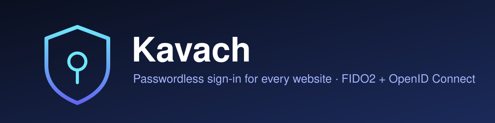
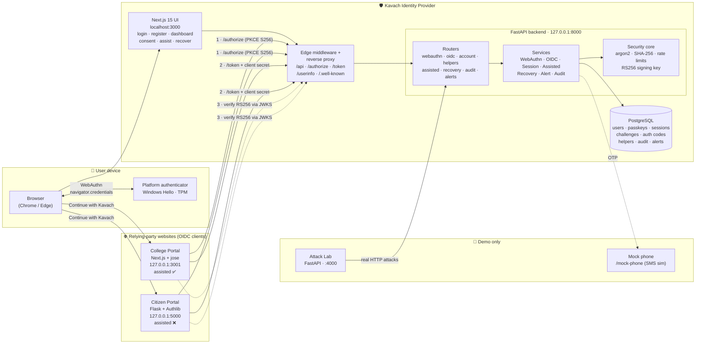
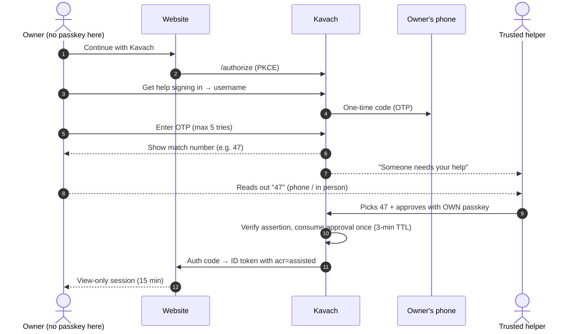

<div align="center">

<!-- Swap for a real screenshot any time: docs/assets/banner.svg -->


# 🛡️ Kavach

### Passwordless sign-in for every website — with a safe way to help people who can't use a passkey.

[](https://github.com/Vertexx1-SIH2026/Kavach/actions/workflows/ci.yml)
[](LICENSE)
[](#)
[](CONTRIBUTING.md)


**[Features](#-key-features) · [Architecture](#-system-architecture) · [Quick start](#-getting-started) · [Security](#-security-model) · [Roadmap](#-roadmap) · [Team](#-team)**

</div>

---

## 📌 Executive Summary

### The problem

Passwords are the weakest link in digital identity. They get phished on look-alike sites, reused across services, leaked in database breaches, and intercepted through SIM-swapped OTPs. Every website that runs its own login re-creates the same risk.

Passkeys (FIDO2 / WebAuthn) fix this — but two gaps keep them from replacing passwords:

1. **Integration cost.** Each website has to implement WebAuthn on its own.
2. **People get left behind.** Elderly users, people with disabilities, or anyone on a shared or borrowed device often *cannot* use a passkey. Today they fall back to passwords, or hand their credentials to a relative — which defeats the purpose.

### The solution

**Kavach** is a passkey-first **identity provider**. Users sign in with the fingerprint, face or PIN of their own device; nothing is typed, so there is nothing to phish. Websites add a **"Continue with Kavach"** button through standard **OpenID Connect** — any off-the-shelf OIDC library works.

**Key innovations**

| | Innovation | Why it matters |
|---|---|---|
| 🤝 | **Assisted sign-in** | A trusted helper approves **one** login with **their own** passkey. The owner never shares credentials, and the website is told it is an assisted, **view-only** session (`acr=assisted`). |
| 🔢 | **Number matching** | The helper must pick the number the owner reads out — stops push-fatigue and blind approvals. Two wrong picks cancel the request. |
| 🔌 | **Drop-in for any website** | Standard OIDC Authorization Code + PKCE (S256) with RS256 tokens. Proven with two different client stacks (Next.js + `jose`, Flask + Authlib). |
| 🧰 | **Self-service recovery** | Offline recovery code + OTP → new passkey; all old passkeys and sessions revoked. |
| 🚨 | **Live Attack Lab** | A demo console that fires real attacks (replay, phishing origin, PKCE theft, forged approvals…) at the running system and shows each one being blocked. |

---

## ✨ Key Features

<details open>
<summary><b>👤 For users</b></summary>

- **Passkey registration and login** with Windows Hello / Touch ID / Android biometrics — `userVerification=required`, enforced server-side.
- **Multiple passkeys** per account (e.g. laptop + phone backup), with device model detection (AAGUID).
- **Security dashboard** — active sessions, connected sites, passkeys, audit log and a **security score**.
- **Sign-in alerts** for new devices and new passkeys, with a one-click *"This wasn't me"* that revokes the offending passkey/session.
- **Sign out all other sessions** in one click.
- **Account recovery** with an offline recovery code + OTP.
</details>

<details open>
<summary><b>🤝 For trusted helpers (assisted sign-in)</b></summary>

- Owners **invite** trusted helpers; helpers must **accept** the relationship.
- Owner starts a request → confirms with an **OTP** to their registered phone (max 5 tries) → reads out a number.
- Helper reviews the request, **picks the matching number**, and approves with **their own passkey**.
- Assisted sessions last **15 minutes**, are flagged `acr=assisted`, and **cannot** manage passkeys, helpers, sessions, recovery or alerts.
</details>

<details open>
<summary><b>🌐 For websites (relying parties)</b></summary>

- OIDC discovery at `/.well-known/openid-configuration`, JWKS at `/.well-known/jwks.json`.
- Authorization Code flow with **mandatory PKCE (S256)**, 60-second single-use codes, exact-match redirect URIs.
- RS256-signed ID and access tokens; `/userinfo`; RP-initiated logout.
- Per-client policy: `allow_assisted=false` to refuse assisted logins, or request it via `acr_values`.
- One-line client registration: `python -m app.cli register-client`.
- Embeddable button script: `frontend/public/kavach-button.js`. See [`docs/integration.md`](docs/integration.md).
</details>

<details open>
<summary><b>🛡️ For judges & security reviewers</b></summary>

- **28 automated security tests** (`backend/tests/test_security.py`) driving a software authenticator through every attack path.
- **Attack Lab** at `localhost:3000/lab` — a visual version of those tests against the live system.
- One-page [threat model](docs/threat-model.md) and [firewall / network hardening guide](docs/firewall.md).
</details>

---

## 🏗️ System Architecture



### Assisted sign-in flow



### Tech stack

| Layer | Technology | Purpose |
|---|---|---|
| **Frontend** | Next.js 15 (App Router), React 19, Tailwind CSS 4, Three.js | Kavach UI, consent and assisted flows, 3D landing globe |
| | `@simplewebauthn/browser` | WebAuthn ceremonies in the browser |
| **Backend** | Python 3.11+, FastAPI, Uvicorn, Pydantic Settings | Identity provider REST API |
| | `webauthn` (py_webauthn), Authlib | FIDO2 verification, OIDC / JOSE |
| **Database** | PostgreSQL 16/17, SQLAlchemy 2, psycopg 3 | Users, passkeys, sessions, codes, audit trail |
| **Demo clients** | Next.js + `jose` · Flask + Authlib | Two independent OIDC relying parties |
| **Security** | argon2-cffi, `cryptography`, RS256 JWT, PKCE S256 | Secret hashing, token signing, code binding |
| **Testing** | pytest, FastAPI TestClient, software authenticator | 28 end-to-end security tests |
| **DevOps** | GitHub Actions, Windows batch scripts, VS Code tasks, Windows Firewall scripts | CI, one-click setup / start, demo hardening |

> **Note:** Kavach uses no AI/ML models — every security decision is deterministic and cryptographically verifiable.

### Repository layout

```
kavach/
├── backend/                  FastAPI + PostgreSQL — the identity provider (port 8000)
│   ├── app/api/              HTTP routers (webauthn, oidc, account, helpers, assisted, recovery, audit, alerts)
│   ├── app/services/         Business logic per domain
│   └── tests/                28 security tests + software authenticator
├── frontend/                 Next.js — Kavach's own pages (port 3000, proxies to the backend)
├── portals/college-portal/   Demo website #1 — Next.js, minimal standard OIDC client (port 3001)
├── portals/citizen-portal/   Demo website #2 — Flask + Authlib, off-the-shelf OIDC client (port 5000)
├── attack-lab/               Demo-only attack console (server on 4000, page at localhost:3000/lab)
├── docs/                     Integration guide, demo script, threat model, firewall guide
├── firewall/                 Windows Firewall on/off scripts for the demo laptop
├── setup.bat                 One-time install (Windows)
└── start-all.bat             Starts all apps + the Attack Lab in separate windows (Windows)
```

---

## 🚀 Getting Started

### Prerequisites

| Tool | Version | Notes |
|---|---|---|
| Python | **3.11 or 3.12** | Avoid free-threaded builds |
| Node.js | **20+** | npm included |
| PostgreSQL | **16 or 17** | Service must be running |
| Git | any recent | |
| Browser | Chrome or Edge | Passkey support |
| Authenticator | **Windows Hello** (at least a PIN) | Settings → Accounts → Sign-in options |

### 1. Clone the repository

```bash
git clone https://github.com/Vertexx1-SIH2026/Kavach.git
cd kavach
```

### 2. Create the databases (once per machine)

Open **SQL Shell (psql)** as `postgres`, then:

```sql
CREATE USER kavach WITH PASSWORD 'kavach';
CREATE DATABASE kavach OWNER kavach;
CREATE DATABASE kavach_test OWNER kavach;  -- used only by the automated tests
\q
```

### 3. Configure environment variables

Every app ships a `.env.example`. Copy each one — the defaults work for local development and match `backend/seed_clients.json`.

```bash
cp backend/.env.example                 backend/.env
cp frontend/.env.example                frontend/.env.local
cp portals/college-portal/.env.example  portals/college-portal/.env.local
cp portals/citizen-portal/.env.example  portals/citizen-portal/.env
```

<details>
<summary>Windows (cmd) equivalent</summary>

```bat
copy backend\.env.example backend\.env
copy frontend\.env.example frontend\.env.local
copy portals\college-portal\.env.example portals\college-portal\.env.local
copy portals\citizen-portal\.env.example portals\citizen-portal\.env
```
</details>

| File | Key variables |
|---|---|
| `backend/.env` | `DATABASE_URL`, `RP_ID`, `ORIGIN`, `ISSUER`, `COOKIE_SECURE`, `DEMO_MODE`, `TRUSTED_PROXIES` |
| `frontend/.env.local` | `KAVACH_ENABLE_LAB` (demo only), `KAVACH_LAB_API` |
| `portals/*/.env(.local)` | `KAVACH_ISSUER`, `KAVACH_CLIENT_ID`, `KAVACH_CLIENT_SECRET`, `REDIRECT_URI`, `SESSION_SECRET` |

> ⚠️ The RSA signing key (`backend/keys/kavach_private.pem`) is generated automatically on first start and is **never committed**.

### 4. Install dependencies

**Windows (one click):** double-click **`setup.bat`**.

**Manual (any OS):**

```bash
# Backend
cd backend
python -m venv .venv
source .venv/bin/activate          # Windows: .venv\Scripts\activate
pip install -r requirements.txt
cd ..

# Kavach UI and College Portal
npm install --prefix frontend
npm install --prefix portals/college-portal

# Citizen Portal
cd portals/citizen-portal
python -m venv .venv
source .venv/bin/activate          # Windows: .venv\Scripts\activate
pip install -r requirements.txt
cd ../..
```

### 5. Run locally

**Windows (one click):** double-click **`start-all.bat`** (opens one window per app), or in VS Code press **Ctrl+Shift+B** → *Start Kavach*.

**Manual — one terminal each:**

```bash
# 1. Backend API
cd backend && source .venv/bin/activate
uvicorn app.main:app --reload --no-proxy-headers --host 127.0.0.1 --port 8000

# 2. Kavach UI
npm run dev --prefix frontend

# 3. College Portal
npm run dev --prefix portals/college-portal

# 4. Citizen Portal
cd portals/citizen-portal && source .venv/bin/activate
flask --app app run -h 127.0.0.1 -p 5000

# 5. (optional) Attack Lab — reuses the backend venv
cd attack-lab && ../backend/.venv/bin/python -m uvicorn lab:app --host 127.0.0.1 --port 4000
```

Health check: <http://localhost:3000/api/health> → `{"ok": true, "database": "connected"}`

| App | URL | Notes |
|---|---|---|
| **Kavach** | **http://localhost:3000** | Always `localhost`, never `127.0.0.1` — passkeys are bound to the hostname |
| College Portal | http://127.0.0.1:3001 | Allows assisted sign-in (view-only mode) |
| Citizen Portal | http://127.0.0.1:5000 | Requires a passkey (assisted sign-in disabled) |
| API docs (Swagger) | http://127.0.0.1:8000/docs | For developers |
| Attack Lab | http://localhost:3000/lab | Needs `KAVACH_ENABLE_LAB=1` — see [`attack-lab/README.md`](attack-lab/README.md) |

### 6. Run the security test suite

```bash
cd backend && source .venv/bin/activate
python -m pytest -v
```

### 5-minute smoke test

1. **Register** — http://localhost:3000 → *Create account* → Windows Hello → save the recovery code.
2. **Log out and back in** — Dashboard → *Sign out* → *Sign in with passkey*.
3. **College Portal** — http://127.0.0.1:3001 → *Continue with Kavach* → *Allow*.
4. **Citizen Portal** — http://127.0.0.1:5000 → *Continue with Kavach* → *Allow*.
5. **Assisted sign-in** (two accounts):
   - Second Chrome profile → register user `helper`.
   - Owner profile → Dashboard → *Trusted helpers* → invite `helper`; helper accepts.
   - Incognito window → College Portal → *Continue with Kavach* → *Get help signing in* → owner's username → enter the code from the simulated phone → a number appears.
   - Helper profile → *Someone needs your help* → pick the number → approve with Windows Hello → owner lands on the portal in **view-only** mode.

Full presenter script: [`docs/demo-script.md`](docs/demo-script.md).

<details>
<summary><b>Maintenance & troubleshooting</b></summary>

**Reset between rehearsals**

```bash
cd backend && source .venv/bin/activate && python -m app.reset_db
```

Then delete old **localhost** passkeys in *Settings → Accounts → Passkeys*.

**Register another website**

```bash
python -m app.cli register-client --name "My Site" --redirect-uri http://127.0.0.1:4000/callback
```

| Problem | Fix |
|---|---|
| "Passkeys only work at http://localhost:3000" / SecurityError | You opened `127.0.0.1:3000`. Use `localhost:3000`. |
| No Windows Hello prompt | Set a Windows Hello PIN; use Chrome or Edge. |
| `connection refused` to PostgreSQL | Start the PostgreSQL service and check `DATABASE_URL`. |
| `password authentication failed for user "kavach"` | Re-run the SQL in step 2 or fix the password in `backend/.env`. |
| Portal says "Kavach discovery failed" | Kavach UI (3000) and backend (8000) must both be running. |
| "This sign-in attempt expired" | Challenges last 2 minutes — just click again. |
| Windows offers an account that doesn't work | You reset the database; delete old localhost passkeys. |
</details>

---

## 🔐 Security Model

| Threat | Mitigation |
|---|---|
| Phishing / look-alike site | WebAuthn binds signatures to origin + RP ID; nothing typed to steal |
| Database breach | Only public keys and hashes stored (SHA-256 for tokens/codes/OTPs, argon2 for secrets) |
| Replay | Fresh 32-byte challenge, 2-minute expiry, consumed atomically |
| Stolen authorization code | 60-second single-use codes bound to client + redirect URI + PKCE |
| Forged ID token | RS256 signatures verified via JWKS (`iss`, `aud`, `exp`, `nonce`) |
| Helper push fatigue | Number matching; two wrong picks cancel |
| SIM swap | OTP alone never grants access |
| Brute force | Per-IP rate limits; `X-Forwarded-For` trusted only from configured proxies |
| Session theft | HttpOnly + SameSite=Lax cookies, rotated after login, no tokens in localStorage |

Full table and known limits: [`docs/threat-model.md`](docs/threat-model.md).

---

## 🗺️ Roadmap

**Delivered**

- [x] Passkey registration and login (FIDO2 / WebAuthn, user verification enforced)
- [x] OpenID Connect provider — discovery, JWKS, Authorization Code + PKCE S256, RS256 tokens
- [x] Two demo relying parties on different stacks (Next.js, Flask)
- [x] Assisted sign-in with OTP, number matching and view-only `acr=assisted` sessions
- [x] Per-website policy to refuse assisted logins
- [x] Recovery with offline code + OTP, revoking old passkeys and sessions
- [x] Security dashboard — sessions, passkeys, connected sites, audit log, security score
- [x] New-device / new-passkey alerts with *"This wasn't me"*
- [x] Per-IP rate limiting with trusted-proxy handling
- [x] 28 automated security tests + live Attack Lab
- [x] One-click Windows setup and firewall hardening scripts

**Next**

- [ ] Real SMS / email gateway (replace the simulated phone)
- [ ] Shared rate-limit store (Redis) for multi-instance deployments
- [ ] Admin-verified recovery for users who lose both passkey and recovery code
- [ ] Database migrations with Alembic
- [ ] Docker Compose for one-command, cross-platform startup
- [ ] Hardware security key (YubiKey) attestation policies
- [ ] Multilingual UI (Hindi and regional languages) and screen-reader audit
- [ ] Production deployment guide (TLS, reverse proxy, secret management)

---

## 👥 Team

<table>
  <thead>
    <tr>
      <th align="center">Member</th>
      <th>Role</th>
      <th>Key contributions</th>
      <th>GitHub</th>
    </tr>
  </thead>
  <tbody>
    <tr>
      <td align="center"><br/><b>Rohaan Ahmad Quadri</b></td>
      <td>Frontend & Security Developer</td>
      <td>Core frontend, firewall integration, backend refinement</td>
      <td><a href="https://github.com/RohaanAhmadQuadri">@RohaanAhmadQuadri</a></td>
    </tr>
    <tr>
      <td align="center"><br/><b>Piyush Singh</b></td>
      <td>Backend & Security Testing</td>
      <td>Backend logic, system stress-testing, crash diagnostics</td>
      <td><a href="https://github.com/PiyushSingh256">@PiyushSingh256</a></td>
    </tr>
    <tr>
      <td align="center"><br/><b>Ujjawal Kumar</b></td>
      <td>Backend Developer</td>
      <td>Server-side APIs, database & backend modules</td>
      <td><a href="https://github.com/UjjawalKr-01">@UjjawalKr-01</a></td>
    </tr>
    <tr>
      <td align="center"><b>Priyanshi</b></td>
      <td>Frontend Developer</td>
      <td>UI/UX development, frontend layouts & styling</td>
      <td>—</td>
    </tr>
  </tbody>
</table>

### Acknowledgments

- [FIDO Alliance](https://fidoalliance.org/) and the [W3C WebAuthn](https://www.w3.org/TR/webauthn-3/) specification
- [py_webauthn](https://github.com/duo-labs/py_webauthn), [SimpleWebAuthn](https://simplewebauthn.dev/), [Authlib](https://authlib.org/), [jose](https://github.com/panva/jose)
- CyberCup 6.0 organisers and mentors

---

## 🤝 Contributing

Pull requests are welcome. Branch from `develop`, use [Conventional Commits](https://www.conventionalcommits.org/) (`feat:`, `fix:`, `docs:` …), make sure `python -m pytest` passes, and open a PR. See [CONTRIBUTING.md](CONTRIBUTING.md).

## 📄 License

Released under the [MIT License](LICENSE).

<div align="center"><sub>Built with 🛡️ for a passwordless, inclusive internet.</sub></div>
